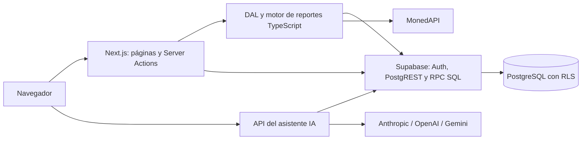
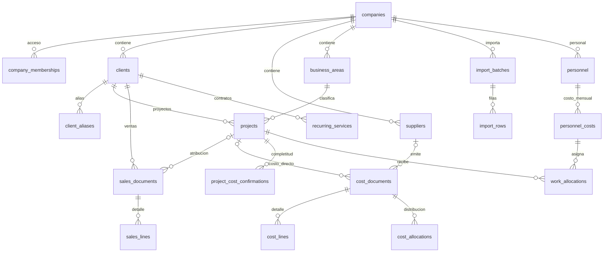

# Relevamiento técnico y funcional — INMA ERP

**Fecha:** 15 de septiembre de 2026  
**Repositorio:** `G:\INMA-ERP`  
**Estado auditado:** `main`, commit `e28a503` — merge de PR #97.  
**Referencia remota disponible localmente:** `origin/main` apunta al mismo commit. No se hizo `fetch`; esto describe el checkout y las referencias disponibles, no garantiza que GitHub no haya recibido cambios posteriores.

## Alcance y método

Este informe se construyó nuevamente desde los archivos y el historial actuales. Las conclusiones no se heredaron de relevamientos anteriores.

Se inventariaron los 479 archivos versionados, los 153 archivos de `web/src`, las 28 migraciones y las referencias Git locales. Se revisaron el modelo SQL, políticas, funciones, rutas, acciones, consultas, cálculos financieros, importador, asistente IA, configuración y documentación funcional. La inspección de la aplicación combinó lectura dirigida del código con búsquedas globales y análisis sintáctico de los archivos TypeScript/TSX. Las herramientas BMAD se identificaron como infraestructura de desarrollo: sus tests no se contabilizaron como tests del ERP.

**Límites de la evidencia:** no se inició sesión ni se consultaron tablas del Supabase remoto; no se verificaron el esquema efectivamente desplegado, datos reales, usuarios, backups, logs o configuración de Vercel. “Implementado” significa que existe el flujo en código y SQL; no equivale a una certificación de funcionamiento en producción. Las reproducciones financieras utilizaron el código actual transpiliado en memoria con consultas simuladas, sin ejecutar SQL ni acceder a datos del ERP.

No se modificaron archivos existentes, no se instalaron dependencias, no se ejecutaron migraciones, no se hicieron deploys ni commits. **El único archivo creado es este informe.** El archivo no versionado `tatus` ya existía al comenzar y no se tocó.

---

## A. Resumen ejecutivo

**El ERP tiene una cobertura funcional amplia, pero todavía no ofrece una base suficientemente consistente para considerar sus distintos reportes una única fuente confiable de rentabilidad.** Hay altas y mantenimiento de maestros, ingresos, costos, importaciones, recurrentes, personal, distribución de costos y reportes. La novedad más reciente es un asistente IA configurable por usuario, con consultas y borradores que requieren confirmación antes de guardarse.

Los principales hallazgos del estado actual son:

1. **Los reportes no usan la misma base financiera:** el resultado mensual descuenta costos netos; cliente, proyecto y área descuentan costos con IVA. Un costo neto de 100 con impuesto de 19 aparece como 100 en un reporte y 119 en otros.
2. **La multimoneda dentro de una empresa no está resuelta:** documentos USD y UYU/CLP se suman numéricamente y se presentan en la moneda de la empresa. La consolidación convierte después ese resultado, por lo que no corrige la mezcla inicial.
3. **Las notas de crédito positivas aumentan las ventas:** el tipo de documento está disponible, pero no cambia el signo en los cálculos.
4. **Faltan costos en los rollups de cliente y área:** la mano de obra asignada y las distribuciones dirigidas a proyectos no ascienden a esas dimensiones. Además, una venta puede computarse completa en dos áreas distintas.
5. **El drill-down no siempre explica la cifra:** usa fecha documental aunque el reporte use período reconocido; tampoco incluye todos los componentes de costos ni todas las ventas por área.
6. **La conversión USD tiene una contradicción entre código y RLS:** se hace `upsert` de cotizaciones, pero la tabla sólo tiene políticas de lectura e inserción. Una actualización fallida se registra en consola y aun así se devuelve la cotización nueva.
7. **La calidad no está protegida por una suite del ERP:** no hay tests automatizados de negocio/RLS ni CI versionada. Lint falla; la instalación local no contiene los tres SDK nuevos de IA y TypeScript no pasa en este entorno.

**Evaluación general:** adecuado como aplicación en desarrollo con flujos operativos presentes; requiere corregir y reconciliar el motor financiero, asegurar las invariantes de datos y establecer pruebas antes de dar por validada la rentabilidad mensual o consolidada.

### Verificaciones realizadas en este relevamiento

| Verificación | Resultado actual |
|---|---|
| Estado Git y diff de archivos existentes | Sin cambios versionados; `?? tatus` preexistente |
| `npm run lint` | Falla: 1 error y 5 advertencias |
| `tsc --noEmit --incremental false` | Falla: 3 módulos IA ausentes y 8 errores derivados de tipado implícito |
| Parseo sintáctico de TS/TSX de `web/src` | Sin errores de sintaxis encontrados |
| Pruebas con fixtures en memoria | 10 escenarios; resultados detallados en G |
| Patrones de secretos en archivos de texto versionados actuales | Sin coincidencias de claves privadas/secretas de los patrones inspeccionados |
| Consulta de advisories npm sobre versiones del lockfile | HTTP 200; 478 nombres de paquetes, sin coincidencias vulnerables devueltas para esas versiones |
| Build | No ejecutado: faltan dependencias y se evitó generar/reemplazar `.next` en este relevamiento |
| Pruebas de producción, proveedores IA o Supabase | No ejecutadas |

El resultado de advisories no prueba ausencia de vulnerabilidades. El escaneo de secretos no cubre todos los formatos posibles, historial Git completo ni configuración externa.

## B. Arquitectura actual

### B.1. Stack y versiones

Versiones resueltas por `web/package-lock.json`, contrastadas con `node_modules` cuando existen:

| Componente | Versión resuelta | Estado local / uso |
|---|---:|---|
| Next.js | 16.3.5 | Instalado; App Router |
| React / React DOM | 19.2.8 | Instalados |
| TypeScript | 5.9.3 | Instalado; `strict: true` |
| Tailwind CSS | 4.3.3 | Instalado; tokens y estilos propios |
| ESLint | 9.39.5 | Instalado; configuración Next y TypeScript |
| `@supabase/ssr` | 0.12.7 | Clientes SSR y cookies |
| `@supabase/supabase-js` | 2.116.0 | Auth, PostgREST y RPC |
| PapaParse | 5.7.0 | Lectura CSV |
| `react-day-picker` | 10.0.1 | Selector de fechas |
| `@anthropic-ai/sdk` | 0.125.0 | Declarado, **no instalado localmente** |
| `openai` | 7.15.0 | Declarado, **no instalado localmente** |
| `@google/genai` | 2.22.0 | Declarado, **no instalado localmente** |
| Node / npm del equipo | 22.18.0 / 10.9.3 | No implica igual runtime en Vercel |
| PostgreSQL | 17 en `supabase/config.toml` | Versión local prevista; remota no verificada |

`package.json` no define script de tests. Los scripts son `dev`, `build`, `start` y `lint`. No se encontró una política versionada de `engines`/runtime que asegure paridad entre equipos y hosting.

### B.2. Estructura del repositorio

```text
INMA-ERP/
├── web/                       Aplicación Next.js
│   ├── src/app/               Páginas, layouts, acciones y endpoints
│   ├── src/components/        Componentes visuales y chat
│   ├── src/lib/               DAL, reportes, moneda, IA y Supabase
│   ├── public/                Assets; incluye remanentes del scaffold
│   ├── package*.json          Dependencias y versiones fijadas
│   └── vercel.json            Región de funciones
├── supabase/
│   ├── migrations/            28 migraciones SQL
│   └── config.toml            Configuración para Supabase local
├── docs/                      PRD, arquitectura y manual
├── _bmad-output/              Specs, estado de historias y decisiones
├── _bmad/                     Herramientas/configuración de desarrollo
└── .claude/                   Skills BMAD y configuración de ejecución
```

La aplicación contiene **43 páginas, 28 archivos `actions.ts`, 3 Route Handlers y aproximadamente 20.371 líneas en `web/src`**. No hay un backend independiente, ORM, worker de importaciones, cola de tareas ni paquete de dominio compartido separado.

### B.3. Flujo de ejecución



- **Rutas por empresa:** `web/src/app/companies/[id]`, con dashboard, maestros, ventas, costos, personal, recurrentes y reportes.
- **Rutas globales:** `/login`, `/companies`, `/reports/consolidated` y `/settings/ai`.
- **Endpoints IA:** `/api/assistant/chat`, `/api/assistant/confirm`, `/api/assistant/models`.
- **DAL:** `web/src/lib/dal.ts`, 1.947 líneas aproximadamente; concentra autenticación, consultas, tipos y normalización de relaciones.
- **Motor:** `web/src/lib/reporting.ts`, 1.277 líneas; realiza sumas y agregaciones en TypeScript después de descargar filas.
- **Escrituras:** acciones de servidor y endpoint de confirmación; combinan escrituras directas en tablas y RPC transaccionales.
- **Separación servidor/cliente:** `dal.ts`, `exchangeRates.ts` y módulos IA tienen `server-only`; los formularios interactivos son Client Components. No se encontraron imports de ejecución evidentes desde componentes cliente hacia esos módulos en el escaneo realizado.

### B.4. Next.js, Supabase y Vercel

- `web/next.config.ts` está prácticamente vacío: no define límites especiales de Server Actions, cabeceras propias, estrategia de imágenes ni configuración de reportes.
- `web/src/middleware.ts` conserva el nombre antiguo como workaround documentado en el código para un problema de routing de Vercel. Usa `getClaims()`, protege rutas y redirige al login. No se comprobó si el problema del proveedor que motivó el workaround sigue vigente.
- La DAL verifica usuario con `auth.getUser()` y `React.cache`; el nombre local `getSession` **no** significa que esté confiando en `supabase.auth.getSession()`.
- `React.cache` se usa para deduplicar lecturas dentro del render/request compatible; no constituye un cache persistente compartido. Los filtros construidos como objetos nuevos no aseguran reutilización por igualdad de valores.
- `web/vercel.json` fija `regions: ["gru1"]` — São Paulo. No acredita la región de Supabase ni la configuración efectiva del proyecto Vercel.
- El esquema documentado de deploy usa `web` como raíz. No hay CI propia, workflow de migraciones ni configuración de proyectos `.vercel` versionada.
- `next/font/google` carga Archivo y JetBrains Mono en `src/app/layout.tsx`; la generación del build depende también de la disponibilidad de esas fuentes o su cache.

### B.5. Variables y configuración externa

| Requisito | Evidencia / dependencia |
|---|---|
| `NEXT_PUBLIC_SUPABASE_URL` | Obligatoria en `src/lib/supabase/env.ts` |
| `NEXT_PUBLIC_SUPABASE_ANON_KEY` | Obligatoria; cliente público con sesión y RLS, no `service_role` |
| Credenciales del asistente | Se almacenan por usuario en `user_ai_settings`; no se leen de variables `OPENAI_API_KEY`/`ANTHROPIC_API_KEY` en la app |
| MonedAPI | URL fija `https://monedapi.ar/api/v2`, sin clave en el código |
| Supabase remoto | Requiere migraciones aplicadas, permisos SQL/Data API, usuarios y membresías |
| Auth | Site URL, redirects, SMTP, registro, claves de firma y MFA dependen de la configuración efectiva del proyecto |
| Hosting | Variables por entorno, raíz `web`, integración Git, dominio, runtime y límites de funciones se configuran externamente |

Las dos variables Supabase están presentes y no vacías en `.env.local`; no se imprimieron sus valores. El archivo está ignorado. Las referencias `OPENAI_API_KEY`, SMTP o S3 de `supabase/config.toml` pertenecen a servicios opcionales/locales de Supabase, no son requisitos adicionales demostrados del frontend.

## C. Funcionalidades implementadas

**Estado “implementado” = flujo presente en código y migraciones.** Las limitaciones que impiden certificarlo completo se detallan en D, G y H.

| Módulo | Comportamiento presente | Evidencia principal |
|---|---|---|
| Empresas Chile y Uruguay | Alta, edición, país, moneda CLP/UYU/USD, estado y membresía admin para el creador; admite más de dos empresas | `companies/new`, `[id]/edit`, `create_company` |
| Clientes | Alta/edición/desactivación, datos fiscales y notas; advertencia por nombre similar | `[id]/clients`, `getClients`, `findSimilarClients` |
| Proveedores | Mantenimiento equivalente a clientes; detección orientativa por nombre | `[id]/suppliers`, `findSimilarSuppliers` |
| Áreas | Alta/edición por admin, desactivación, unicidad por empresa/nombre sin distinguir mayúsculas y áreas iniciales | `[id]/areas`, migraciones story 1.5 |
| Proyectos | Cliente y área obligatorios, fechas, estado, responsable y presupuesto | `[id]/projects`, `projects_validate_company_refs` |
| Ingresos manuales | Formulario completo para ambas empresas, múltiples líneas, impuesto, moneda y proyecto opcional | `[id]/sales/new`, `create_sales_document` |
| Ingreso rápido Uruguay | Cliente, fecha, importe y área; documento manual, IVA 0 y moneda UYU; preserva datos para carga repetida | `[id]/sales/quick` |
| Edición/anulación de ingresos | Reemplazo transaccional de líneas; anulación lógica con usuario/fecha; acción desde listado | `[salesDocumentId]/edit`, `VoidDocumentRowAction`, RPC de ventas |
| Costos y gastos | Alta de documento, líneas e impuesto; directo requiere proyecto y general no lo admite; detalle de sólo lectura financiera | `[id]/costs`, `create_cost_document` |
| Distribución de costos | General a dos o más destinos, por porcentaje o monto; reemplazo del conjunto, ayudas de reparto y saldo | `costs/.../allocate`, `set_cost_allocations`, `allocations.ts` |
| Pendiente/cero confirmado | Estados calculados por proyecto activo y mes; confirmar y quitar confirmación | `getProjectCostStatus`, `project_cost_confirmations` |
| CSV de Chile | Carga, mapeo, preview, parser de fechas, alias, alta automática de clientes con RUT y RPC por lote | `sales/import`, `csvDate.ts`, `import_sales_rows_batch` |
| Duplicados | Ventas importadas comparadas con existentes; posibilidad de forzar con trazabilidad; advertencia de costos | migración story 4.2, `findPotentialDuplicateCost` |
| Historial de importación | Lotes, contadores, filas, errores/duplicados, JSON original y vínculo al documento | `sales/import-history`, `import_batches`, `import_rows` |
| Recurrentes | Servicio con precio/costo esperado, periodicidad, vigencia y cliente; generación explícita de una venta por período | `[id]/recurring-services`, `generate_recurring_service_entry` |
| Personal | Empleado/socio, costo mensual y moneda, unicidad persona/período | `[id]/personnel`, `personnel_costs` |
| Asignación de trabajo | Importes de personal a proyectos; horas opcionales informativas; remover asignación | `allocate_work`, `work_allocations` |
| Resultado mensual | Ventas netas, costos directos, margen, gastos generales, personal y resultado operativo | `computeMonthlyResult` |
| Rentabilidad | Cliente, proyecto y área; proyecto también acumulado y desvío de presupuesto | `getProfitabilityBreakdown`, `ProfitabilityTabs` |
| Reconocimiento | Trasladar íntegramente una venta/costo a un mes diferente, con quién/cuándo | RPC `reassign_*_document_period` |
| Consolidado USD | Resultado por empresa, conversión CLP/UYU vía ARS, total y empresas pendientes de cotización | `/reports/consolidated`, `exchangeRates.ts` |
| Dashboard | KPIs, comparación mensual, serie de 12 meses, waterfall, proyectos y advertencia de costos pendientes | `[id]/page.tsx`, `MonthlyChart`, `Waterfall` |
| Guía y navegación | Sidebar, guía de uso, estados de carga y sistema visual compartido | `Sidebar`, `AppShell`, `[id]/guide`, `loading.tsx` |
| Autenticación/permisos | Email/contraseña, logout, cookies SSR, protección por membresía y RLS | middleware, DAL, migraciones de auth |
| Asistente IA nuevo | Configuración personal de proveedor/modelo/key; listado de modelos; consultas y propuestas de venta/gasto con confirmación humana | `lib/ai`, `api/assistant`, `AssistantChat` |

Las diez pruebas locales de G validaron aspectos concretos del código, no el circuito UI → Supabase real. No corresponde etiquetar todos estos módulos como “funcionando en producción” sin esa verificación adicional.

## D. Funcionalidades parciales o pendientes

| Funcionalidad | Clasificación actual | Qué falta o limita su uso |
|---|---|---|
| Rentabilidad confiable y conciliada | Parcial | IVA, signos, monedas, rollups y detalle no coinciden; ver G |
| Excel nativo | Pendiente | Sólo PapaParse y aceptación `.csv,text/csv`; no parser `.xlsx`/`.xls` |
| Importación de costos | Pendiente | No hay flujo ni RPC de importación de documentos de proveedores |
| Dedupe venta-costo de proveedor | Pendiente/redefinido | No existe relación venta/línea ↔ costo/línea; story 3.4 terminó como aviso de duplicado por proveedor/fecha/total |
| Edición/anulación de costos | Pendiente | No hay edición financiera ni anulación; el trigger impide cambios financieros. Sí permite reasignar período |
| Edición de ingresos completa | Parcial | No se puede quitar proyecto/área mediante `null`; falta auditoría de versiones anteriores |
| Cero confirmado/completitud | Parcial | Ignora asignaciones, trabajo y período reconocido; sólo proyectos activos; ventas sin proyecto no tienen esta cobertura |
| Asignación de gastos generales | Parcial | Obliga a dos destinos y al total del documento; no permite dejar remanente general en el mismo reparto ni asignar 100% a un único destino |
| Servicios recurrentes | Parcial | Generación manual del período actual; sin scheduler, recuperación de meses omitidos en UI, costo automático ni atribución a proyecto/área |
| Costo esperado de recurrentes | Informativo | Se guarda y muestra; no participa como costo real ni comparación presupuestaria del servicio |
| Costos de personal | Parcial | No hay UI de edición del costo mensual aunque el mensaje de duplicado recomienda editarlo; faltan controles de signo |
| Horas | Parcial según alcance de negocio | Se registran, pero no calculan dinero ni hay tarifa/hora, partes diarios o aprobación |
| Presupuestado vs real | Parcial | Un presupuesto global de costo por proyecto; sin presupuesto mensual, ingresos presupuestados, revisiones o línea base |
| Reconocimiento multi-mes | Parcial | Mueve el documento entero; no reparte montos entre meses, no ofrece restablecer `null`, no bloquea períodos cerrados |
| Drill-down | Parcial | Filtros no equivalentes al motor; faltan asignaciones/personal en el detalle y enlaces en algunas cifras del dashboard |
| Consolidación | Parcial | Sólo convierte la moneda base de cada empresa; sin conversión por documento ni eliminaciones interempresa |
| Administración de acceso | Parcial | Sin UI de usuarios/membresías, invitación, recuperación de contraseña, MFA ni rol de sólo lectura |
| Storage/adjuntos | Pendiente | Servicio habilitado en config local, sin buckets/políticas o llamadas de Storage en la app; no conserva el archivo original |
| Cierres y auditoría completa | Pendiente | No hay `management_periods`, cierre, bloqueo, historial anterior/posterior ni bitácora del chat/confirmaciones |
| IA | Parcial | Adaptadores y correcciones presentes, pero sin pruebas de contratos, idempotencia ni presupuestos robustos de consumo |

### Implementaciones reemplazadas, duplicadas o desactualizadas

- **Reemplazada:** la aplicación ya usa `import_sales_rows_batch`; `import_sales_row` permanece en SQL sin llamada desde la app, como camino legado todavía ejecutable.
- **Reemplazadas en la UI principal:** las consultas individuales `computeClientProfitability`, `computeAreaProfitability`, `computeProjectProfitability` permanecen, aunque el reporte y dashboard usan `getProfitabilityBreakdown`. Conservan una segunda implementación de las mismas reglas.
- **Revertida:** la adopción del selector de mes personalizado en listados y el mes actual por defecto. Ventas/Costos actuales usan `input type="month"` sin obligar al mes actual. El selector de fechas y `PeriodPicker` siguen vigentes donde se usan.
- **Reemplazada:** `proxy.ts` por `middleware.ts` mediante el fix de Vercel.
- **Desactualizados:** README raíz dice “definición de esquema”; README de `web` sigue siendo el scaffold y habla de Geist; `decisiones-abiertas.md` mantiene decisiones que ya tienen una implementación. `deferred-work.md` conserva el diferimiento original de story 3.4 aunque hubo una implementación posterior con alcance reducido.
- **No hay evidencia suficiente para declarar un módulo de negocio abandonado.** Hay planes no implementados y código legado; la ausencia de commits posteriores por sí sola no demuestra abandono.

## E. Cambios recientes relevantes

### E.1. Nuevas funciones y fixes más recientes

| Commit / rama | Cambio comprobado en el diff actual | Evaluación |
|---|---|---|
| `971ddfb` — `feature-ai-assistant` | Chat flotante, settings por usuario, 3 SDK, herramientas de consulta/propuesta y endpoint de confirmación | Ampliación de arquitectura y superficie de seguridad; añade `user_ai_settings` |
| `7c6c559` — `feature-ai-assistant-model-picker` | Descubrimiento de modelos del proveedor desde una key | No garantiza compatibilidad de todos los modelos listados con las herramientas usadas |
| `73177b8` — `fix-ai-settings-save` | Añade `created_by/updated_by` a settings para compatibilidad con trigger; listas estáticas antes de tener key | Corrige el error de actualización en el esquema versionado; requiere que la migración esté aplicada externamente |
| `74c4ebe` — `improve-ai-assistant-guardrails` | 24 mensajes, 200 documentos por listado enviado al modelo, aviso de gasto duplicado y detalle de errores | Reduce carga, pero no limita bytes/tokens de entrada, frecuencia ni salida de todos los proveedores |
| `2755462` — `fix-gemini-thought-signature` | Preserva `thoughtSignature` y la repite en el mismo fragmento al continuar una llamada de herramienta | Fix presente en el adaptador; no probado contra Gemini en este relevamiento |
| `18521ec` — `fix-gemini-function-response-array` | Envuelve arrays/escalares como objeto para `functionResponse.response` | Fix presente; HEAD integra PR #97 |
| `d9bf6f6`, `ee81b0f`, `062bd74` | Parser dd/mm/ISO, alias, anulación desde listado, creación automática de clientes, prioridad Monto neto/IVA y RUT | Fechas comprobadas en memoria; el parseo de importes regionales sigue defectuoso |
| `3505d41` | Separa `formatPeriod` de un módulo cliente para resolver error 500 en detalle de costo | Helper actual en `lib/period.ts` |

El tramo `8bca02c..e28a503` contiene **18 archivos afectados, 2.599 inserciones y 10 eliminaciones**, concentradas en IA y su integración. Esto se obtuvo del diff Git: ese tramo no rediseña el motor financiero ni sustituye sus consultas.

### E.2. Performance y rediseño

| Commit | Cambio actual |
|---|---|
| `2df0ed9`, `949f1b8` | Sistema visual, shell, sidebar fija, componentes y pantallas |
| `8b68845`, `aadf4a6` | Rediseño del detalle/distribución de costos y del historial de importaciones |
| `f576eb4` / `2ee38eb` | Dedupe de autenticación y shell paralelo; sus árboles no presentan diferencias en la comparación efectuada |
| `29cfb24` | Cache por request de maestros y skeleton de consolidado |
| `e64b088` | Serie de 12 meses consultada por rango; rentabilidad por empresa en lugar de una batería por entidad; skeletons |
| `6f6d6ad` | Paralelización adicional, joins para personal y `getClaims()` en middleware |
| `c42db63` | Región `gru1` e importación por un RPC de lote |
| `d1004c8` | Orden por fecha/importe y filtro mensual en ventas/costos |
| `78ed0bd`, `3749905` | Reversiones del selector de mes y de su valor inicial por defecto |

**Mejora comprobable estructural:** el reporte pasó de consultas proporcionales a clientes/proyectos/áreas a 8 consultas de hechos más 3 listas maestras por empresa, antes de auth/shell. La serie mensual concentra lecturas por rango. El importador evita una llamada de red por fila.

**Límite de esa mejora:** no se midieron latencias reales ni planes SQL; las consultas siguen descargando filas completas sin paginación y los acumulados leen toda la historia. Menos round trips no implica que los resultados estén completos ni que escale indefinidamente.

### E.3. Ramas y obsolescencia

`git branch -a --no-merged main` no devolvió ramas. Las referencias locales disponibles de `feature`, `fix`, `perf`, `story` y `redesign` están integradas en `main`; no se detectó otra implementación pendiente de merge en esas referencias. `audit/relevamiento-2026-09-15` ya existía y apunta al mismo HEAD.

No se eliminaron ramas. Las referencias de historias sirven como historial, pero no deben tomarse como versiones alternativas vigentes del ERP. El código vivo es el de `main` y las migraciones acumuladas, incluyendo reemplazos de firmas y reversiones.

## F. Estado de Supabase y modelo de datos

**Lo siguiente describe el esquema reconstruido desde las migraciones; no es un inventario del servidor remoto.** No hay evidencia obtenida en este trabajo de que las 28 estén aplicadas a la base conectada.

### F.1. Tablas y relaciones

| Tabla | Datos y relaciones principales | Restricciones / observaciones |
|---|---|---|
| `companies` | Nombre, país, tax ID, moneda, activa | Moneda CLP/UYU/USD; país es texto libre |
| `company_memberships` | Usuario de `auth.users`, empresa, rol | Único usuario/empresa; rol texto sin catálogo/check |
| `clients` | Empresa, nombre, datos fiscales, notas, activo | No hay unicidad fiscal; similitud se trata como advertencia |
| `client_aliases` | Empresa + nombre externo normalizado → cliente | Único empresa/nombre externo; falta comprobar empresa del cliente en SQL |
| `suppliers` | Empresa, nombre, datos fiscales, activo | Sin unicidad fiscal |
| `business_areas` | Empresa, nombre, activo | Índice único empresa/`lower(name)` |
| `projects` | Empresa, cliente, área, fechas, estado, presupuesto, responsable | Cliente/área obligatorios; trigger de pertenencia a empresa |
| `sales_documents` | Empresa, cliente, proyecto/área opcionales, tipo, fecha, moneda, neto/IVA/total | Origen manual/import/recurring, anulación, duplicado y período reconocido |
| `sales_lines` | Documento de venta, descripción, importe | Las sumas del header se calculan en RPC; no existe invariante universal header ↔ líneas |
| `cost_documents` | Empresa, proveedor opcional, proyecto, clasificación, fecha, moneda e importes | Directo exige proyecto; general exige proyecto nulo; período reconocido |
| `cost_lines` | Documento de costo, descripción, importe | Sin edición financiera por UI |
| `cost_allocations` | Documento de costo → proyecto, cliente o área | Exactamente un destino por fila y método porcentaje/monto; no tiene columna de período propia |
| `project_cost_confirmations` | Proyecto, mes, nota, quién/cuándo | Único proyecto/período; el estado de costos se calcula al leer |
| `import_batches` | Empresa, archivo, contadores, usuario/fecha | No tiene estado de procesamiento/cancelación/reintento |
| `import_rows` | Lote, fila, JSON original, estado/error, documento | Falta unicidad lote/número de fila e idempotencia del procesamiento |
| `recurring_services` | Empresa, cliente, nombre, precio, costo esperado, moneda, periodicidad y vigencia | No tiene proyecto/área propios |
| `personnel` | Empresa, nombre, employee/partner, activo | No equivale a usuarios Auth |
| `personnel_costs` | Persona, mes, importe y moneda | Único persona/período; sin CHECK de importe no negativo |
| `work_allocations` | Costo de personal → proyecto, importe y horas opcionales | El límite al costo disponible está en RPC, sin bloqueo concurrente |
| `exchange_rate_snapshots` | Moneda, mes, ARS/unidad, ARS/USD y fecha de consulta | Compartida entre usuarios; único moneda/período; sin CHECK positivo de tasas |
| `user_ai_settings` | Usuario Auth, proveedor, modelo, API key y auditoría | Una configuración por usuario; API key en texto plano |

Las tablas operativas tienen auditoría de creación/última actualización o campos específicos de origen/confirmación. Eso **no** constituye historial de cambios. No existen tablas `profiles`, `currencies`, `management_periods`, libro contable, pagos, cierres o conversación IA en las migraciones actuales.



El diagrama omite algunas FK de auditoría y los destinos alternativos de asignación para mantenerlo legible. `user_ai_settings` se relaciona con `auth.users`, mientras las cotizaciones son globales.

### F.2. Inventario de migraciones

Todas están en `supabase/migrations`. El orden efectivo es por timestamp, no por número de historia.

| Archivo | Contenido |
|---|---|
| `20260912120000_epic1_story1_auth_foundation.sql` | Empresas, membresías, RLS inicial y trigger de actualización |
| `20260912130000_epic1_story2_manage_companies.sql` | Campos de empresa, política admin y `create_company` |
| `20260912140000_epic1_story2_review_patches.sql` | Validación y permisos de `create_company` |
| `20260912150000_epic1_story3_manage_clients.sql` | Clientes |
| `20260912160000_epic1_story4_manage_suppliers.sql` | Proveedores |
| `20260912170000_epic1_story5_manage_business_areas.sql` | Áreas, políticas admin y seed por empresa |
| `20260912180000_epic1_story5_review_patches.sql` | Unicidad de nombre de área |
| `20260912190000_epic1_story6_manage_projects.sql` | Proyectos |
| `20260912200000_epic1_story6_review_patches.sql` | Validación de empresa en FK de proyectos |
| `20260912210000_epic2_story1_sales_documents.sql` | Ventas, líneas y RPC de creación |
| `20260912220000_epic2_story1_review_patches.sql` | Monedas permitidas en ventas |
| `20260913000000_epic2_story2_edit_void_sales_documents.sql` | Edición/anulación y permisos de líneas |
| `20260913010000_epic2_story3_quick_entry_business_area.sql` | Área en ventas; nuevas firmas RPC |
| `20260913020000_epic3_story1_cost_documents.sql` | Costos, líneas, clasificación y creación |
| `20260913030000_epic3_story2_cost_allocations.sql` | Distribuciones y reemplazo de conjunto |
| `20260913040000_epic3_story3_project_cost_confirmations.sql` | Confirmación de costo cero |
| `20260913050000_epic4_story1_import_sales.sql` | Lotes, filas, origen y RPC de importación |
| `20260913060000_epic4_story2_duplicate_detection.sql` | Duplicados, override y contadores |
| `20260913070000_epic5_story1_recurring_services.sql` | Recurrentes y generación por período |
| `20260913080000_epic5_story2_personnel_costs.sql` | Personas y costos mensuales |
| `20260913090000_epic5_story3_work_allocations.sql` | Costo/horas a proyectos |
| `20260913100000_epic6_story2_sales_project_link.sql` | Proyecto en ventas; reemplaza firmas anteriores de creación/edición |
| `20260913110000_epic6_story6_period_recognition.sql` | Reconocimiento y protección financiera de costos |
| `20260913120000_epic6_story5_exchange_rate_snapshots.sql` | Cotizaciones mensuales compartidas |
| `20260914010000_batch_import_sales_rows.sql` | RPC de importación de lote con aislamiento por fila |
| `20260914020000_client_aliases.sql` | Alias de clientes |
| `20260914030000_ai_assistant_settings.sql` | Configuración IA por usuario |
| `20260915010000_fix_ai_settings_updated_by.sql` | Corrige incompatibilidad de settings con `set_updated_at` |

### F.3. Funciones SQL, triggers y vistas

Se encontraron **24 nombres distintos de funciones**, con 35 definiciones a lo largo de las migraciones debido a reemplazos; **25 triggers, 58 políticas RLS y ninguna vista o vista materializada propia**.

| Grupo | Funciones presentes |
|---|---|
| Infraestructura | `set_updated_at`, `create_company`, `seed_default_business_areas` |
| Integridad de referencias | `projects_validate_company_refs`, `sales_documents_validate_company_refs`, `cost_documents_validate_company_refs`, `cost_allocations_validate_company_refs`, `recurring_services_validate_company_refs`, `work_allocations_validate_company_refs` |
| Ventas | `create_sales_document`, `update_sales_document`, `void_sales_document` |
| Costos | `create_cost_document`, `set_cost_allocations`, `confirm_project_cost_zero`, `cost_documents_protect_financial_fields` |
| Importación | `create_import_batch`, `import_sales_row`, `import_sales_rows_batch`, `update_import_batch_counts` |
| Recurrentes/trabajo | `generate_recurring_service_entry`, `allocate_work` |
| Períodos | `reassign_sales_document_period`, `reassign_cost_document_period` |

Los triggers se distribuyen en actualización de auditoría, seed de áreas, validación de referencias y protección financiera de costos. No hay trigger de cálculo de rentabilidad ni de conciliación general entre cabeceras, líneas y asignaciones.

`create_company`, `seed_default_business_areas` y `update_import_batch_counts` son `SECURITY DEFINER` con `search_path` definido. La primera exige usuario; la última comprueba membresía explícitamente. Las RPC operativas restantes dependen de los permisos/RLS del invocador. Se revoca EXECUTE de PUBLIC y se concede a authenticated en las RPC expuestas revisadas.

### F.4. RLS y permisos

Las **21 tablas propias habilitan RLS**. La regla predominante es pertenencia a empresa, directa o por joins a la cabecera/persona/proyecto.

| Alcance | Acceso versionado |
|---|---|
| Empresas | Lectura por miembro; actualización admin; alta atómica mediante RPC |
| Membresías | Lectura de las propias; sin UI/políticas de administración operativa |
| Áreas | Lectura por miembro; alta/edición admin |
| Clientes/proveedores/proyectos/recurrentes/personal | Miembros pueden leer, crear y actualizar |
| Ventas y líneas | Miembros leen/crean; header actualizable y líneas actualizables/eliminables para edición |
| Costos | Lectura/alta; actualización del header con trigger que bloquea campos financieros |
| Distribuciones y confirmaciones | Lectura, alta y eliminación por miembros según entidad padre |
| Importaciones | Lectura/alta por empresa; contadores mediante RPC con validación |
| Cotizaciones | Cualquier authenticated puede leer e insertar; **no UPDATE** |
| Settings IA | Propietario puede leer, insertar, actualizar y eliminar su fila |

**RLS protege filas, no la consistencia financiera completa.** Un miembro con INSERT/UPDATE en tablas puede omitir validaciones que sólo están en una Server Action o RPC. Además, las migraciones no declaran los GRANT de tablas de forma reproducible; dependen de privilegios existentes/default del proyecto. La documentación de Supabase distingue expresamente privilegios SQL y políticas por operación. [Referencia oficial de RLS](https://supabase.com/docs/guides/database/postgres/row-level-security).

No se verificó la configuración real de exposición de Data API. El `config.toml` local deja comentada la opción de exposición automática y declara `max_rows = 1000`, por lo que esos aspectos requieren comprobación externa antes de afirmar reproducibilidad de una instalación limpia.

### F.5. Auth, Storage y dependencias externas no verificadas

- Login email/contraseña y logout presentes; creación de usuarios/membresías adicionales depende de Supabase. No hay flujo completo de recuperación o MFA en la app.
- `enable_signup = true`, confirmación email deshabilitada y mínimo de contraseña 6 son **valores del archivo local**, no hallazgos confirmados sobre producción.
- Storage está habilitado en config, pero no hay buckets, políticas de objetos, upload/download ni adjuntos implementados en el código ERP.
- `db.seed` apunta a `./seed.sql`, archivo que no está en el repositorio actual. No se ensayó un reset y no debe asumirse que el entorno local se reconstruya sin preparación.
- No se verificaron migraciones remotas, grants, backups/PITR, SMTP, claves de firma JWT, dominios autorizados, límites ni facturación de proveedores.
- No se visitó el consolidado autenticado: `getOrSnapshotRate` puede escribir una cotización durante la lectura del reporte.

## G. Evaluación de la lógica financiera

### G.1. Fórmulas actuales

| Concepto | Implementación actual |
|---|---|
| Período documental efectivo | `recognized_period` cuando existe; en caso contrario mes de `document_date` |
| Ventas netas mensuales | Suma de `sales_documents.net_amount`, excluyendo `voided`; no aplica signo según tipo ni conversión por moneda |
| Costos directos mensuales | Suma de `cost_documents.net_amount` con `classification = direct` |
| Margen directo | Ventas netas − costos directos |
| Gastos generales | Suma neta de documentos generales + **todo** `personnel_costs.amount` del mes, asignado o no |
| Resultado operacional | Margen directo − gastos generales |
| Ingreso por proyecto | Ventas netas directamente vinculadas al proyecto |
| Costo por proyecto | `total_amount` de costos directos + distribuciones al proyecto sobre total con IVA + `work_allocations.amount` |
| Ingreso por cliente | Ventas netas con ese `client_id` |
| Costo por cliente | Costos directos con IVA de sus proyectos + distribuciones dirigidas directamente al cliente |
| Ingreso por área | Ventas con área explícita **o** proyecto de esa área; deduplicación por ID dentro de la misma área |
| Costo por área | Costos directos con IVA de sus proyectos + distribuciones dirigidas directamente al área |
| Margen de entidad | Ingreso de entidad − costo de entidad |
| Acumulado de proyecto | Toda su historia disponible, **sin fecha de corte superior** |
| Desvío presupuestario | Costo acumulado − presupuesto global; positivo indica exceso; presupuesto nulo se conserva como nulo |
| Conversión | `resultado_empresa × ARS_por_moneda / ARS_por_USD`; cada tasa ARS es promedio de compra y venta |

Evidencia: `web/src/lib/reporting.ts`: `computeMonthlyResult` (77), `getMonthlySeries` (216), `computeClientProfitability` (460), `computeAreaProfitability` (552), `computeProjectProfitability` (687), `getProfitabilityBreakdown` (912), `computeConsolidatedResult` (1204). Cotizaciones: `web/src/lib/exchangeRates.ts`.

### G.2. Reproducciones sobre el código actual

Se transpilaron módulos actuales a JavaScript **sólo en memoria**, reemplazando dependencias de red con fixtures. No se guardó una suite ni se ejecutaron migraciones. Los escenarios que comparan consultas usan un simulador de los filtros necesarios; no validan PostgREST ni RLS reales.

| Caso | Entrada | Resultado observado | Interpretación |
|---|---|---|---|
| T1 — IVA | Costo directo neto 100, total 119 | Mensual: costo 100; cliente/proyecto/área: 119 | Bases incompatibles; confirma H01 |
| T2 — Nota de crédito | `credit_note`, neto positivo 100 | Ventas y resultado +100 | No revierte ventas; confirma H03 |
| T3 — Monedas | Venta USD 100 + UYU 4.000 | Ventas 4.100 | Suma sin conversión; confirma H02 |
| T4 — Personal | Trabajo asignado 60 a proyecto | Proyecto: costo 60; cliente: 0; área: 0 | Falta rollup de trabajo; confirma H04 |
| T5 — Dos áreas | Venta 200, área explícita B, proyecto del área A | Mensual 200; área A 200; área B 200 | Suma entre áreas duplica esa venta; confirma H05 |
| T6 — Error de consulta | Fallo simulado al leer costo 100; ventas 200 | Costo 0 y resultado 200, error sólo en log | Resultado incompleto presentado como cifra normal; confirma H06 |
| T7 — Reconocimiento | Venta agosto 200 reconocida en septiembre | Reporte septiembre 200; filtro por fecha septiembre devuelve 0 filas | Reporte y filtro documental divergen; confirma H07 |
| T8 — CSV regional | `1.234,56`; `1234,56`; `1,234.56` | 1.23456; 123456; 1234.56 | Formato regional interpretado incorrectamente; confirma H13 |
| T9 — Fechas CSV | `14/09/2026`, `2026-09-14`, `31/02/2026`, `29/02/2024` | Dos primeras a ISO; fecha imposible rechazada; bisiesto válido aceptado | Corrección de fechas funciona para estos casos |
| T10 — Reparto igual | Total 1.000, tres destinos | 33,33% cada uno → 999,90; faltante 0,10; `matches: false` | El helper de reparto no garantiza un conjunto guardable; confirma H17 |

### G.3. Doble conteo, omisiones y conciliación

**Doble conteo confirmado en el motor:** T5 demuestra duplicación al sumar áreas distintas. No se cuenta dos veces dentro de una misma área porque se usa un Set/Map; el problema surge cuando área explícita y área del proyecto no coinciden. El trigger de ventas valida empresa y cliente del proyecto, pero no igualdad de áreas. Una venta rápida de Uruguay puede conservar su área al editarse y asignarle después un proyecto de otra área.

**Doble conteo potencial por integridad:** un INSERT directo autorizado sobre `cost_allocations` puede asociar distribuciones a un costo directo porque el control “sólo general” está en `set_cost_allocations`, no en la tabla/trigger. El reporte sumaría el costo directo más su asignación. No se ejecutó ese INSERT; es una conclusión de la política y las reglas SQL versionadas.

**Omisiones de costos:** cliente/área no reciben trabajo ni asignaciones dirigidas al proyecto; gastos generales no distribuidos tampoco integran márgenes por entidad. La última exclusión puede ser una decisión gerencial válida si el reporte se define como contribución parcial, pero la UI debe aclararla y ofrecer conciliación con el resultado de empresa.

**No se observó doble cargo automático de personal en el resultado mensual:** éste resta el costo mensual una sola vez y no vuelve a sumar `work_allocations`. Tampoco suma distribuciones además del gasto general original. Por ello no deben sumarse los costos de distintos reportes entre sí como si fueran conjuntos independientes.

**Diferencias frontend/SQL:** las distribuciones SQL redondean cada cuota a dos decimales antes de validar el total; TypeScript utiliza flotantes y porcentajes sin el mismo redondeo. El preview de duplicados CSV redondea el total, mientras la búsqueda SQL compara el numeric exacto. El motor dice en comentarios que usa netos en todas las dimensiones, pero sus consultas usan `total_amount` en rentabilidad.

### G.4. Consolidación y períodos

El consolidado convierte `operatingResult` según `companies.currency`; documentos y costos de personal conservan monedas independientes. No hay normalización previa por documento, por lo que la conversión posterior no arregla importes mezclados.

Para el mes actual se intenta cotización en vivo y `upsert`. Para otros meses se lee sólo el snapshot existente. Si falta, la empresa aparece pendiente y se excluye del total. La UI conoce ese estado, pero una cifra consolidada parcial no equivale al resultado del grupo completo.

No se verifica la antigüedad de `updatedAt`/`lastScrapedAt`, no hay timeout explícito en `fetchArsRate` ni cierre de cotización mensual. El código devuelve el dato nuevo aunque falle guardarlo. No se auditó la exactitud económica ni disponibilidad actual de MonedAPI; se evaluó cómo lo consume esta implementación.

Los acumulados de proyecto no se limitan al mes seleccionado. Cambiar cliente/área de un proyecto puede reclasificar costos históricos al nuevo maestro mientras las ventas conservan su `client_id`. No hay snapshots de dimensiones ni cierre contable que congele esa interpretación.

## H. Problemas y riesgos detectados

**Prioridad:** P0 = impide confiar en resultados; P1 = alto impacto en integridad, operación o seguridad; P2 = deuda/limitación relevante. “Confirmado” se refiere a código o reproducción local; no implica que el caso ya exista en los datos reales.

### H.1. Motor financiero y reportes

| ID | Prioridad | Problema y efecto | Evidencia actual |
|---|---|---|---|
| H01 | P0 | Costos netos en mensual y brutos en entidades; margen y presupuesto incompatibles | `reporting.ts:162`, `:979`, `:1062`, `allocationShare`; migración `20260913030000` usa total |
| H02 | P0 | Monedas mezcladas sin conversión dentro de empresa; cambia el significado de todas las sumas | `reporting.ts:121`, `:967`, `computeConsolidatedResult`; moneda libre entre CLP/UYU/USD en documentos/personas |
| H03 | P0 | Notas de crédito positivas suman ventas en lugar de restarlas | `reporting.ts:157`; `20260913100000` exige líneas > 0 sin distinguir tipo |
| H04 | P1 | Cliente/área omiten mano de obra y distribuciones a proyectos | `reporting.ts:1084`, `:1114`, `:1129`, `:1162`; T4 |
| H05 | P1 | Una venta puede figurar íntegra en dos áreas diferentes | `reporting.ts:1044`; trigger `sales_documents_validate_company_refs` en `20260913100000`; T5 |
| H06 | P0 | Errores de consulta pasan a arrays vacíos y ceros; puede inflarse el resultado | `reporting.ts:131`, `:157`, `:1026`; DAL repite patrón `[]`/`null`; T6 |
| H07 | P1 | Drill-down filtra fecha documental y sólo algunos costos/ventas | `dal.ts:1121`, `:1309`, `:1134`; `reports/profitability/page.tsx:55`; no incluye trabajo/asignaciones y pierde ventas atribuidas por proyecto al área |
| H08 | P1 | Cliente/área sin proyectos puede abrir costos de toda la empresa al ignorarse `projectIds: []` | `dal.ts:1319`; `costs/page.tsx:88`, `:114` |
| H09 | P1 | Pendiente/cero usa fecha documental y costos directos, omite trabajo/distribuciones; sólo estado activo actual | `dal.ts:1660`; `getMonthlySeries` bloque de costDateRows; `confirm_project_cost_zero` en `20260913040000` |
| H10 | P1 | “Total del mes” de costos suma lista sin filtro y no respeta el mes elegido | `costs/page.tsx:78`, `:145`, `:213` |
| H11 | P1 | Acumulados incluyen registros posteriores al mes; edición de cliente/área del proyecto altera imputaciones históricas | `reporting.ts:971`, `:983`, `:997`, `:1010`; `projects/[projectId]/edit/actions.ts:100` |
| H12 | P0/P1 | `upsert` de cotizaciones sin UPDATE RLS; dato mostrado puede diferir del persistido; cualquier authenticated puede insertar tasa global | `exchangeRates.ts`, `20260913120000_epic6_story5_exchange_rate_snapshots.sql` |

### H.2. Importaciones, validación e integridad

| ID | Prioridad | Problema y efecto | Evidencia actual |
|---|---|---|---|
| H13 | P0 | Parser CSV elimina comas; puede multiplicar o reducir fuertemente importes. IVA inválido se convierte en 0 | `sales/import/actions.ts:97`, `:284`; `sales/import/form.tsx:43`; T8 |
| H14 | P1 | Duplicado de venta no incluye moneda, folio o identificador externo; dedupe por costo tampoco incluye moneda y necesita proveedor | `20260914010000` consulta de duplicados; `dal.ts:1443`; falsos positivos/negativos y carrera entre imports |
| H15 | P1 | Creación de clientes/alias, lote, filas y contadores son pasos separados; cancelación/fallo puede dejar maestros/lote sin completar | `sales/import/actions.ts:196`, `:229`, `:250`, `:303`, `:340`; además el nombre exacto tiene precedencia sobre alias al resolver |
| H16 | P1 | Integridad se apoya demasiado en RPC: tabla admite header/líneas inconsistentes; ventas pueden desanularse por UPDATE directo; asignaciones negativas o sobreasignación pueden evadir controles | RLS de ventas/líneas `20260913000000`; tablas/RPC `20260913030000`, `20260913090000`; faltan CHECK/trigger globales |
| H17 | P1 | Distribuciones aceptan valores negativos si compensan el total; redondeo distinto entre SQL/JS y reparto igual incompleto | `set_cost_allocations`, `allocate/actions.ts:96`, `lib/allocations.ts`; T10. Ejemplo -10/+110 satisface total 100 en la RPC |
| H18 | P1 | Lectura y escritura sin bloqueo: dos asignaciones de 60 pueden superar costo de personal 100; reemplazos concurrentes pueden mezclarse; edición/anulación compiten | `allocate_work`, `set_cost_allocations`, `update_sales_document`, `void_sales_document`; no `SELECT ... FOR UPDATE` ni control de versión |
| H19 | P1 | `client_aliases` no valida que el cliente pertenezca a la empresa del alias | `20260914020000`; las FK y RLS sólo cubren cada relación por separado |
| H20 | P1 | Quitar proyecto en edición manda null pero SQL conserva el anterior; un cambio de cliente puede fallar por el proyecto retenido | `sales/[salesDocumentId]/edit/actions.ts:136`; `20260913100000:272` |
| H21 | P1 | Importes de personal y precio/costo esperado recurrente pueden ser negativos; formularios filtran algunas líneas inválidas en vez de rechazar documento completo | acciones `personnel/.../costs/new:45`, `recurring-services/new:58`; migraciones `20260913070000`, `20260913080000`; `sales/new/actions.ts:86`, `costs/new/actions.ts` |
| H22 | P2 | Primer período recurrente puede quedar bloqueado si inicio no es primer día; anual se normaliza a enero aunque empiece después. Anulado sigue ocupando período único | `generate_recurring_service_entry` en `20260913070000`; `recurring-services/page.tsx:17`, `:94` |

**Concurrencia:** H18 y la carrera de deduplicación son riesgos deducidos del SQL; no se generaron escrituras simultáneas contra una base. La generación recurrente sí dispone de índice único servicio/período que previene dos filas iguales, aunque puede devolver un error de conflicto.

### H.3. Seguridad, IA y operación

| ID | Prioridad | Problema y efecto | Evidencia actual |
|---|---|---|---|
| H23 | P1 | API keys IA en texto plano; RLS impide otros propietarios, pero el dueño puede leer el campo por Data API si tiene grants. Enmascararlo en UI no lo vuelve secreto exclusivo del servidor | `20260914030000`, `lib/ai/settings.ts`; `dal.ts:1921` incluso selecciona la clave para derivar `hasApiKey` |
| H24 | P1 | Cambio de proveedor conserva modelo y permite conservar key de otro proveedor; esa key puede enviarse al proveedor nuevo | `settings/ai/form.tsx:111` (`handleProviderChange`); `settings/ai/actions.ts:70` conserva key sin comprobar proveedor anterior |
| H25 | P1 | Límites IA parciales: sólo Anthropic recibe límite de salida; no hay cuota/frecuencia/bytes por mensaje, límite de resultados maestros ni timeout global de turno | `providers.ts:78`, `:116`, `:183`, `:303`; `chat/route.ts:7`, `:14`, `:89`; cortar a 24 mensajes no acota tokens |
| H26 | P1 | Confirmación IA sin token/idempotencia durable: un reintento tras respuesta perdida puede crear otro documento. Advertencia de duplicado sólo al proponer | `api/assistant/confirm/route.ts:90`, `:120`; `AssistantChat.tsx:123`; no registro de confirmación |
| H27 | P1 | IA resuelve por primera coincidencia parcial, puede elegir entidad ambigua; proveedor no encontrado se vuelve null; elimina líneas inválidas y usa IVA 0 si inválido | `lib/ai/tools.ts:69`, `:86`, `:312`, `:328`, `:400`; formularios de confirmación no permiten revisar todo el detalle |
| H28 | P2 | Chats envían datos financieros a terceros; falta registro durable de qué se consultó/confirmó y política operativa de datos. Entradas HTTP tienen tipos TS pero validación runtime incompleta | `chat/route.ts`, `providers.ts`, `AssistantChat`; la pantalla muestra errores del proveedor y debe revisarse qué detalle se expone |
| H29 | P1 | Consultas sin paginación/aggregación SQL: riesgo de sumas truncadas y acumulados incompletos; contadores IA son longitud de lo descargado, no count real | `reporting.ts`, `dal.ts`, `ai/tools.ts:246`, `supabase/config.toml` (`max_rows = 1000`) |
| H30 | P1 | Instalación local desactualizada frente al lockfile; TypeScript no pasa y no se certificó build | `package.json`, `package-lock.json`, ausentes SDK IA en `node_modules` |
| H31 | P1 | Sin tests ERP ni CI; lint falla y documentación histórica no prueba el motor multimoneda actual | `web/package.json`, `sales/quick/form.tsx:56`, `_bmad-output/.../spec-6-7-validate-engine-against-a-real-historical-month.md` |
| H32 | P2 | Roles limitados y configuración externa no reproducida; desactivar empresa no revoca membresía/escrituras; faltan grants y seed local | `company_memberships`, `getCompanyForEdit`, RLS, `supabase/config.toml`; decisiones operativas pendientes |
| H33 | P2 | Carga CSV en memoria sin chunking ni tamaño propio; fallo por límite de Server Actions o timeout de lote grande | `parseImportFile`, `commitImport`, `next.config.ts`; no worker ni cola |
| H34 | P2 | Mes validado sólo por forma `YYYY-MM`, no por rango; parámetros como `2026-13` pueden producir fecha inválida y error de render | dashboard/reportes y acciones de reasignación; `monthRange` usa `toISOString()` |

El límite local de 1.000 filas se declara en el repositorio. No se comprobó el límite remoto ni la cantidad real de documentos: H29 es un riesgo de exactitud especialmente relevante al ampliar de un mes a doce meses o toda la historia. La solución debe asegurar lectura completa o agregación en servidor, no asumir que faltan datos sólo cuando hay un error explícito.

Next.js documenta **1 MB por defecto para cuerpos de Server Actions** y permite configurarlo; el repositorio no lo personaliza. Esto afecta tanto el archivo como la posterior serialización del lote. [Documentación oficial de Server Actions](https://nextjs.org/docs/app/api-reference/config/next-config-js/serverActions).

### Controles positivos observados

- No se usa `service_role` en la aplicación; clientes Supabase usan clave pública y sesión.
- RLS está habilitada en todas las tablas de negocio y settings del esquema versionado.
- Hay validación SQL de referencias entre empresas para proyectos, ventas, costos, recurrentes y asignaciones.
- La RPC recalcula neto/total desde líneas; el endpoint IA no usa sus totales declarados como importe persistido.
- La IA sólo ejecuta herramientas de lectura/propuesta durante el chat. El guardado está separado y requiere acción de confirmación en la interfaz; no se detectó ejecución SQL arbitraria generada por el modelo.
- `user_ai_settings` se devuelve a componentes cliente como proveedor/modelo/booleano, sin API key en props.
- La anulación de ventas conserva registros; el trigger de costos bloquea cambios financieros no autorizados por ese flujo.
- `.env*`, llaves privadas, `.next`, `node_modules` y `.vercel` están ignorados. No se encontraron secretos de los patrones examinados en archivos versionados actuales.

## I. Deuda técnica

### I.1. Código y arquitectura

1. **Motor financiero duplicado.** `computeMonthlyResult` y `getMonthlySeries` implementan agregación mensual en caminos separados; los tres `compute*Profitability` conviven con el breakdown batch. Hay que mantener reglas, signos, filtros y redondeos en varios lugares. El camino batch mejoró performance, pero no eliminó la fuente de divergencias.
2. **DAL monolítica y tipos manuales.** `dal.ts` mezcla Auth, tipos, maestros, importaciones y cálculos de estado. `createServerClient` no está parametrizado con tipos generados del esquema; es más fácil que un cambio SQL quede fuera del chequeo estático.
3. **Reglas repetidas entre UI, acciones y SQL.** Parser de importes duplicado; constantes de moneda repetidas; validaciones por módulo; definición de Draft duplicada entre UI y servidor. Las RPC antiguas de importación también mantienen una segunda versión del procesamiento.
4. **Consultas todavía innecesarias.** Ventas descarga listas completas de clientes/proyectos/áreas para etiquetas de filtros aunque no se usen. Costos obtiene siempre la lista histórica para tarjetas y puede hacer una segunda consulta filtrada. La IA descarga primero todos los documentos disponibles y recién después corta a 200. `getAiSettings` consulta la clave para obtener un booleano en cada shell que lo necesita.
5. **Falta estrategia de volumen.** No hay paginación de documentos/maestros/importaciones, agregaciones SQL financieras ni índices compuestos por empresa/período para los principales filtros. Los `.in(...)` con muchos IDs y joins RLS pueden crecer significativamente. Se requiere medir con datos representativos antes de elegir índices; no se ejecutó EXPLAIN remoto.
6. **Dinero con `number`.** PostgreSQL usa `numeric`, pero JS transforma a flotante y redondea para mostrar. No hay política única de precisión monetaria, redondeo por línea/documento/asignación ni conversiones reproducibles.
7. **Manejo de errores sin contrato uniforme.** `[]`, `null`, cero, error de autorización y error de red pueden representar el mismo estado. Predomina `console.error`; no hay trazas estructuradas, correlación de requests o alerta de reporte incompleto.
8. **Auditoría incompleta.** Último `updated_at/by` no permite reconstruir correcciones; `sales_lines` se reemplazan, y distribuciones se eliminan/reinsertan. Tampoco hay cierre de período o idempotencia transversal de escrituras.
9. **Dependencias de hosting implícitas.** Migraciones y GRANT no están validados desde una base limpia; seed referenciado ausente; no hay pipeline que compruebe orden, permisos y compatibilidad app/esquema antes de publicar.
10. **Documentación desfasada.** README, decisiones abiertas, specs y comentarios contradicen algunos comportamientos actuales. La intención del PRD y los “done” de historias no reemplazan validación funcional.

### I.2. Tests existentes y cobertura

| Área | Evidencia actual | Evaluación |
|---|---|---|
| Tests de negocio TypeScript/React | No se encontraron archivos test/spec de ejecución en `web` ni framework/script de test | Cobertura automatizada identificable del ERP: nula; no existe porcentaje instrumentado medido |
| SQL / RLS | No hay `supabase/tests`, pgTAP ni suite de acceso multiempresa | Integridad y permisos sin regresión automatizada |
| E2E | No hay Playwright/Cypress ni escenarios de navegador versionados | Login, importación, edición y reportes sin prueba integral repetible |
| CI | Sin `.github/workflows` versionado | No hay evidencia de gates de tests propios; integración Vercel externa no comprobada |
| Herramientas BMAD | 11 archivos `test_*.py` bajo `.claude/skills/.../scripts/tests` | Prueban herramientas de desarrollo, no el ERP; no se ejecutaron |
| Specs/historias | Casos y registros de verificación manual en `_bmad-output` | Material útil para diseñar tests, no tests ejecutables |
| Fixtures de este relevamiento | 10 escenarios en memoria, G.2 | Reproducciones puntuales; no se añadieron como suite al repositorio |

**Sobre la validación histórica story 6.7:** el documento versionado registra cargas y comparaciones manuales de enero, por empresa y moneda, contra un Excel. Describe una consulta SQL agrupada y un ajuste del procedimiento de carga que retuvo el rol privilegiado. No demuestra hoy la ejecución de `computeMonthlyResult` con monedas mezcladas, ni la UI completa ni el aislamiento RLS de usuarios reales. No se reutilizaron esos resultados como validación del estado actual.

### I.3. Resultado exacto de validaciones locales

**Lint: 1 error, 5 advertencias.**

- Error `react-hooks/set-state-in-effect`: `web/src/app/companies/[id]/sales/quick/form.tsx:56`, actualización síncrona de estado dentro de `useEffect`.
- Advertencia `react-hooks/exhaustive-deps`: `sales/import/form.tsx:222`, dependencia `resolveClientId` ausente.
- Dos advertencias de parámetros sin usar: `sales/[salesDocumentId]/edit/actions.ts:207` y `:208`.
- Dos advertencias de variables sin usar: `web/src/lib/dal.ts:1539`.

**TypeScript: 11 errores en el entorno actual.**

- Tres `TS2307` por módulos no instalados: `@anthropic-ai/sdk`, `openai`, `@google/genai`, en `web/src/lib/ai/providers.ts:3`, `:4`, `:5`.
- Ocho `TS7006` sobre parámetros de callbacks en ese archivo, al faltar los tipos inferidos de los SDK.
- No se atribuyen automáticamente esos ocho errores a una falla del código con instalación correcta: hay que sincronizar dependencias y volver a validar para determinarlo.
- El análisis sintáctico de TS/TSX no encontró errores de parseo; eso no reemplaza la comprobación semántica o build.

No se ejecutó `npm install`/`npm ci`, build ni pruebas que creen datos. No se certifica que el build pase después de instalar dependencias: ese resultado sigue pendiente de verificar.

### I.4. Riesgos de regresión principales

- Cambiar una consulta optimizada sin actualizar sus equivalentes individuales.
- Corregir IVA en reportes sin migrar/interpretar las distribuciones históricas basadas en total.
- Implementar monedas sólo en consolidado y dejar crudos los reportes de empresa/proyecto.
- Cambiar período reconocido sin actualizar detalle y completitud.
- Agregar un proveedor/modelo IA sin contratos de tool calls, límites y mensajes.
- Reintentos o concurrencia que dupliquen ventas, costos, importaciones o asignaciones.
- Desplegar app con nuevas columnas antes de aplicar y verificar la migración correspondiente.

## J. Prioridades recomendadas

### Prioridad inmediata: exactitud y trazabilidad de resultados

Resolver H01/H02/H03/H06/H13 como conjunto prioritario: base neta, conversión por moneda, signo de documentos, fallos visibles y parseo monetario. Hasta entonces, un resultado visualmente normal puede ser incorrecto sin que la pantalla lo advierta.

El criterio de éxito debe ser una conciliación explícita: documentos válidos → resultado mensual → rentabilidad por dimensión → drill-down → consolidado. Las diferencias intencionales, como gastos generales no distribuidos, deben aparecer como remanentes identificados y no perderse silenciosamente.

### Prioridad alta: integridad y pruebas repetibles

Crear fixtures deterministas y protección automatizada para cálculos, RLS, dedupe, reconocimiento e idempotencia. Fortalecer invariantes SQL para todos los caminos autorizados de escritura y usar bloqueos/versionado donde hay lectura seguida de decisión y escritura.

Verificar después, en un entorno separado autorizado, que una base nueva pueda reconstruirse con las migraciones y permisos versionados. La instalación local debe sincronizarse con el lockfile antes de extraer conclusiones sobre estabilidad de build.

### Prioridad alta: completar la IA de forma operable

Mantener la confirmación humana, pero añadir idempotencia, resolución no ambigua de entidades, presentación de todas las líneas, control consistente de keys/proveedores y límites de consumo. La nueva integración no debe reproducir ni ocultar errores del motor financiero subyacente.

### Prioridad posterior: cerrar el alcance funcional

Definir la necesidad de Excel nativo, edición/anulación de costos, recurrentes automáticos, valuación de horas y distribución multi-mes. Actualizar PRD/manual/estado de historias según esas decisiones. Son trabajos funcionales distintos de las correcciones necesarias para confiar en los cálculos actuales.

## K. Próximos 10 trabajos concretos, ordenados por prioridad

Estos son trabajos propuestos. **Ninguno se implementó en este relevamiento.**

| # | Trabajo concreto | Archivos/tablas de partida | Criterio verificable de terminación |
|---|---|---|---|
| 1 | Preparar una validación reproducible: sincronizar dependencias en entorno autorizado, corregir lint y añadir fixtures de los casos de G | `package*.json`, configuración CI/tests, `providers.ts`, `sales/quick/form.tsx` | `npm ci`, lint, TypeScript y build pasan en entorno limpio; tests reproducen las inconsistencias financieras antes de corregirlas |
| 2 | Unificar el motor de importes netos y signos de documentos, usando una política monetaria de precisión | `reporting.ts`, RPC ventas, `allocations.ts`, tablas de asignaciones | IVA recuperable no reduce margen; factura 100 + NC 30 = ventas 70; implementaciones batch/individual/serie dan el mismo resultado |
| 3 | Implementar normalización multimoneda por documento y costo de personal, y hacer coherente la persistencia de cotizaciones | `exchangeRates.ts`, `exchange_rate_snapshots`, `reporting.ts` | USD y moneda local nunca se suman crudos; mismo snapshot produce mismo histórico; fallo de tasa/escritura se refleja explícitamente |
| 4 | Corregir importación monetaria regional y dedupe/idempotencia del lote | `sales/import`, `csvDate.ts`, `import_rows`, `import_sales_rows_batch`, `client_aliases` | Casos CL/UY de miles/decimales y moneda se validan; no se convierte IVA inválido a cero; reintentar lote no duplica filas ni clientes |
| 5 | Reconciliar cliente/proyecto/área, mano de obra y distribuciones; definir área única o regla explícita de reparto | `getProfitabilityBreakdown`, funciones individuales, proyectos y ventas | Costos atribuibles ascienden consistentemente; venta no cuenta completa en dos áreas; remanentes generales quedan visibles |
| 6 | Unificar período efectivo, acumulado a fecha, drill-down y estado pendiente/cero | DAL, páginas de costos/ventas/reportes, `project_cost_confirmations`, RPC de reconocimiento | Toda cifra enlaza a componentes que suman exactamente; `projectIds: []` da vacío; reconocidos y costo cero usan la misma regla; acumulados respetan corte |
| 7 | Fortalecer invariantes SQL y concurrencia de escrituras | `sales_documents/lines`, `cost_documents/lines`, `cost_allocations`, `personnel_costs`, `work_allocations` | Escritura directa autorizada no evade totales/signos/estado; dos asignaciones concurrentes no exceden disponible; edición/anulación tiene control de conflicto |
| 8 | Hacer explícitos los estados de error y asegurar consultas completas a volumen | DAL, `reporting.ts`, listas, índices SQL | Fallo de costos no muestra ganancia normal; dataset > 1.000 filas reconcilia exactamente; filtros/paginación/count no ocultan documentos |
| 9 | Completar seguridad y estabilidad del asistente IA | settings, `lib/ai`, `api/assistant`, `AssistantChat`, `user_ai_settings` | Cambiar proveedor exige credencial compatible; límites de entrada/salida/frecuencia por proveedor; confirmación idempotente; entidades ambiguas se consultan; contratos de Gemini/Anthropic/OpenAI cubiertos |
| 10 | Cerrar alcance operativo y documentación con matriz de aceptación | costos, recurrentes, personal, importador, docs y configuración Supabase/Vercel | Backlog acordado de edición/anulación de costos, Excel, recurrentes y horas; runbook de entorno/migraciones/backups y permisos; manual y “done” reflejan capacidades verificadas |

La revisión del esquema remoto y cualquier migración/deploy necesarios para estos trabajos deben tratarse como una etapa posterior. Este informe no presupone autorización para ejecutarlos.

---

## Referencias y trazabilidad

Las rutas y líneas del informe corresponden al checkout `e28a503`; las líneas pueden cambiar en commits posteriores. Para ubicar un hallazgo, se priorizan los nombres de función, tabla y migración indicados.

- Código de la aplicación: `web/src/app`, `web/src/components`, `web/src/lib`.
- Esquema previsto: los 28 archivos de `supabase/migrations` inventariados en F.2.
- Requisitos: `docs/prd.md`, `docs/architecture.md`, `docs/manual-usuario.md`, `docs/decisiones-abiertas.md`.
- Historial funcional: `_bmad-output/implementation-artifacts`, commits y ramas enumerados en E.
- Documentación oficial consultada para contrastar comportamiento de plataforma: [políticas RLS y privilegios](https://supabase.com/docs/guides/database/postgres/row-level-security), [consulta select de Supabase](https://supabase.com/docs/reference/javascript/select), [límites de Server Actions](https://nextjs.org/docs/app/api-reference/config/next-config-js/serverActions).
- Seguridad de dependencias: consulta read-only de advisories sobre versiones públicas del lockfile al [endpoint de seguridad del registro npm](https://registry.npmjs.org/-/npm/v1/security/advisories/bulk), sin instalar paquetes ni modificar lockfile. No hubo coincidencias vulnerables en la respuesta recibida.

**Conclusión:** hay una implementación operativa extensa y cambios recientes concretos, especialmente IA, UX y reducción de consultas. La prioridad actual es asegurar que sus importes, períodos, monedas y permisos produzcan resultados verificables y consistentes antes de ampliar el alcance funcional.
